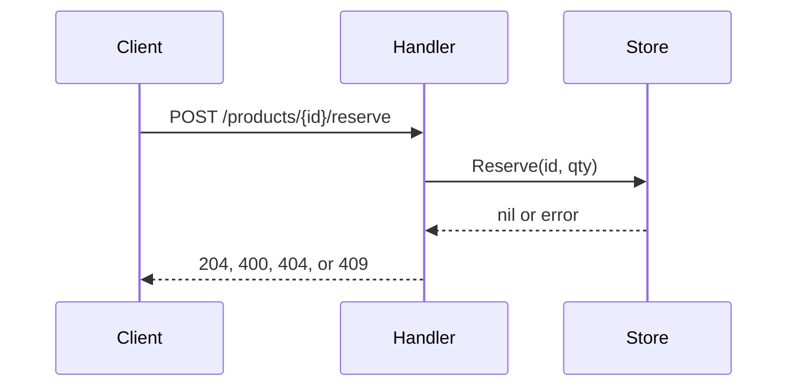

# Writing style

Four rules apply to all writing. Each section below shows what they mean in practice.

1. Code comments are short and explain why, not how.
2. Code comments stand on their own.
3. Use plain English.
4. Number lists that have an order.

## 1. Comments explain why, not how

Comment only what the code can't say for itself: a reason, a constraint, a surprising consequence, or a warning.

| Don't | Do |
| --- | --- |
| `// Increment the counter.` | No comment. The code says it. |
| `// Loop over the products and add each price to the total.` | No comment. |
| `// Use a map for O(1) lookups.` | No comment, unless the choice is surprising. |
| (no comment on a surprising choice) | `// URL.Query drops pairs it cannot parse, which would turn a malformed limit into the default instead of a 400.` |
| `// Sleep 50ms.` | `// The device rejects commands sent less than 50ms apart.` |

Doc comments on public functions and types describe behavior, not implementation: what it takes, what it returns, which errors it returns and when, and whether it is safe for concurrent use.

```go
// Bad: describes the implementation.
// Split computes base = total / n and then loops over parts adding 1 to the
// first total % n entries.

// Good: describes the behavior.
// Split divides total into n parts that sum exactly to total and differ by
// at most one cent, with the larger parts first. It returns an error
// wrapping ErrInvalidSplit if total is negative or n is outside [1, MaxParts].
```

Never commit commented-out code. Delete it; git keeps the history.

### TODOs

A TODO says what is missing and why, in a way that makes sense on its own:

```go
// Bad
// TODO: fix this
// TODO: see plan 0004 task 3

// Good
// TODO: support currencies other than USD; amounts are stored as US cents only.
```

Every new TODO goes to Phil, who decides whether to fix it now or remove it. List each one in your summary and in the pull request under "Decisions for Phil". A pull request that adds TODOs is opened as a draft, so it can't be merged until Phil decides.

## 2. Comments stand on their own

Write every comment for a reader who has never seen the plan, the review, the ticket, or this conversation. State the reason itself instead of pointing somewhere else.

| Don't | Do |
| --- | --- |
| `// Fix for review finding 2.` | `// Cap the page size so one request can't return the whole catalog.` |
| `// Implements task 3 of docs/plans/0001-pagination.md.` | No comment, or the reason the code exists. |
| `// As requested, return 409 here.` | `// 409 tells the client the stock changed; retrying may succeed.` |
| `// See decision 0002.` | `// Money is stored as integer cents; floats can't represent most decimal amounts exactly.` |
| `func TestReviewFinding1(t *testing.T)` | `func TestListPastEndReturnsEmptyPage(t *testing.T)` |

Links to stable outside sources are fine when the comment still makes sense without following them:

```go
// Timestamps use RFC 3339 (https://www.rfc-editor.org/rfc/rfc3339) so
// clients in any time zone parse them the same way.
```

Plans, decision records, and pull requests may link to code. Code never links back to them.

## 3. Plain English

Use the simplest words that are still accurate. A technical term is fine when the reader needs it; explain it the first time it appears.

Spell out an abbreviation on first use, for example "time to live (TTL)", unless a developer would know it without looking it up:

| Leave as is | Spell out on first use |
| --- | --- |
| HTTP, URL, JSON, API, ID, SQL, CPU, US, UTC | TTL, RBAC, SLO, CQRS, project-specific abbreviations |

Flagging a common abbreviation is not a WRITING finding.

| Instead of | Write |
| --- | --- |
| utilize, leverage | use |
| facilitate | help, allow |
| in order to | to |
| idempotent | safe to run more than once |
| performant | fast (say how fast if it matters) |
| robust, seamless, best-in-class | say what it actually does |
| prior to | before |
| a number of | some, several, or the number |

Write short sentences in the active voice: "The handler rejects empty values", not "Empty values are rejected by the handler".

### Explain steps with a list or a diagram

When something happens in steps, number them:

```markdown
A reservation works like this:

1. Lock the store.
2. Check the product exists and has enough stock.
3. Subtract the quantity and save the product.
4. Unlock the store.
```

In code comments, use plain-text diagrams:

```go
// Request flow:
//
//   client ──▶ handler ──▶ store.Reserve ──▶ map (under lock)
//                 │
//                 └── 400/404/409 on validation errors
```

In Markdown docs, Mermaid diagrams are allowed:

````markdown

````

## 4. Lists

1. If the items have a natural order (steps, priority, severity, importance, time), number every item: 1, 2, 3, through the last. Twenty items are numbered 1 to 20.
2. Put the first step, or the most important item, first.
3. Use bullets only when there is no natural order, such as a set of options or a list of files.
4. Number nested lists the same way. Never write roman numerals (i, ii) or letters (a, b) as list markers. Some renderers show nested numbers as roman numerals; that's fine.

## Commit messages and pull requests

1. The commit subject is a Conventional Commits line in plain English: `fix: return an empty page for offsets past the end`.
2. The body explains why, in short sentences. Naming the plan file in a commit message or pull request is fine; those are documents, not code.
3. Pull request descriptions follow every rule above, and list new TODOs under "Decisions for Phil".

## Reviewing writing

When reviewing, report a clear break of rules 1 to 4 as a **WRITING** finding. Each one needs:

1. The exact text, with file and line.
2. The rule it breaks.
3. A rewrite, or "delete" when the comment shouldn't exist.

Phrasing you would merely prefer, but that breaks no rule, is a NIT.
